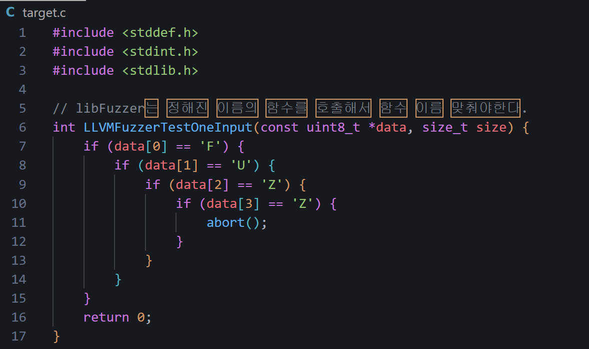
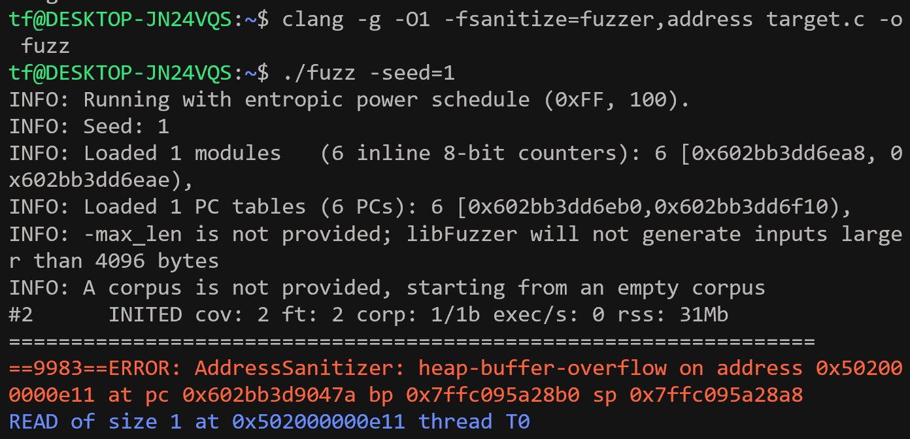
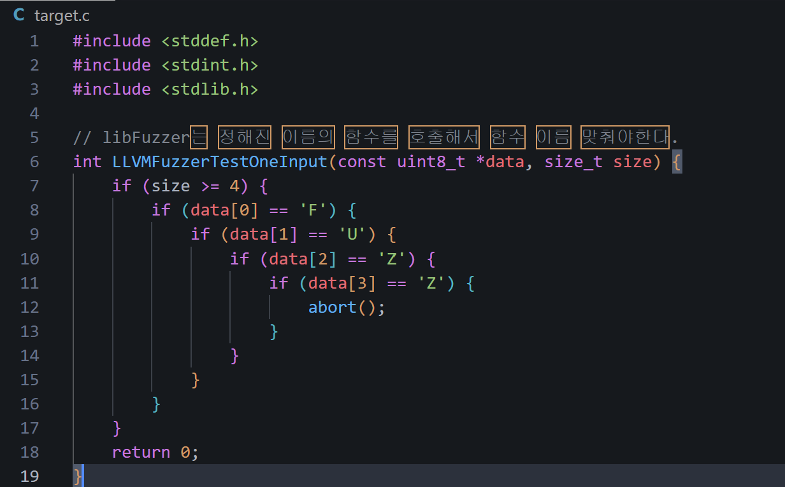
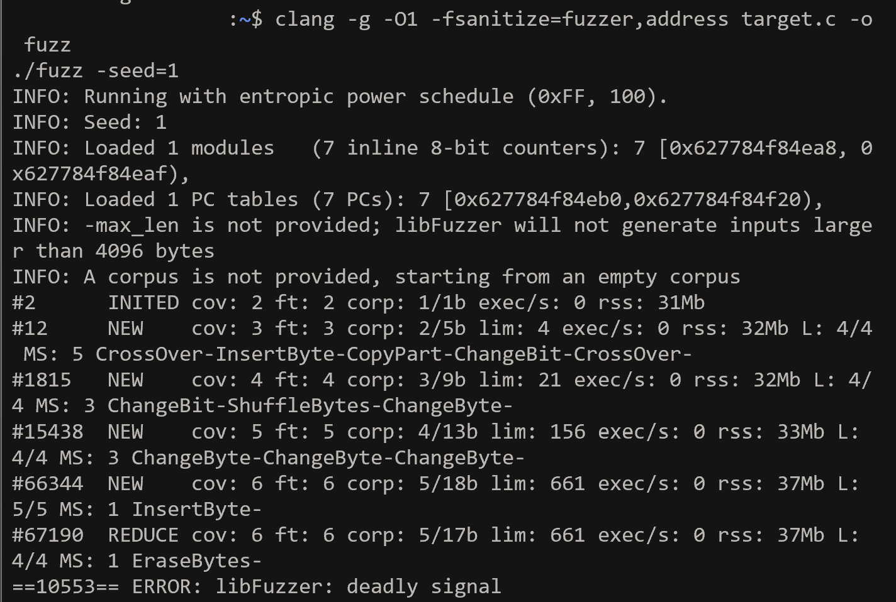
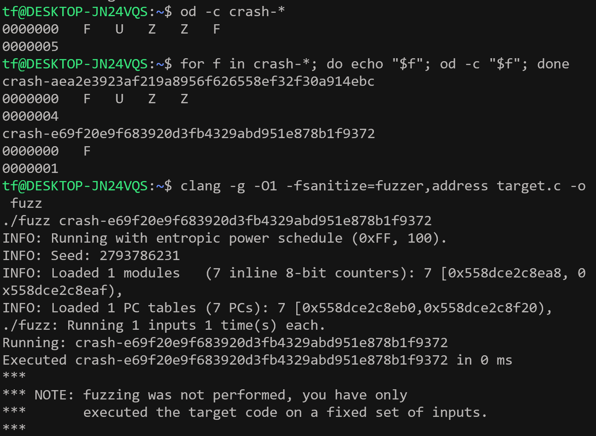
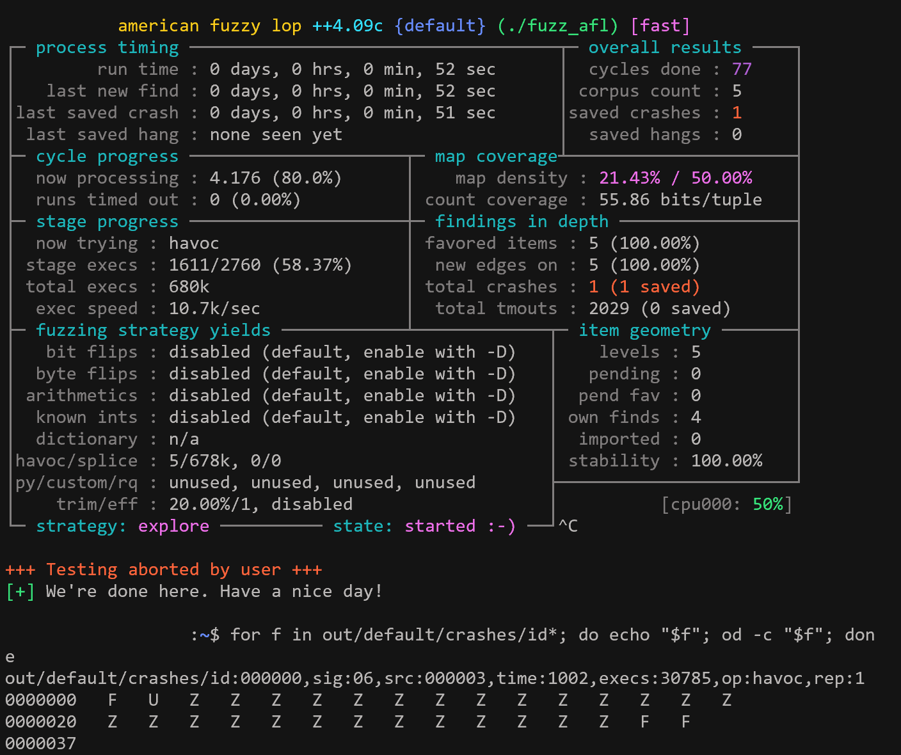
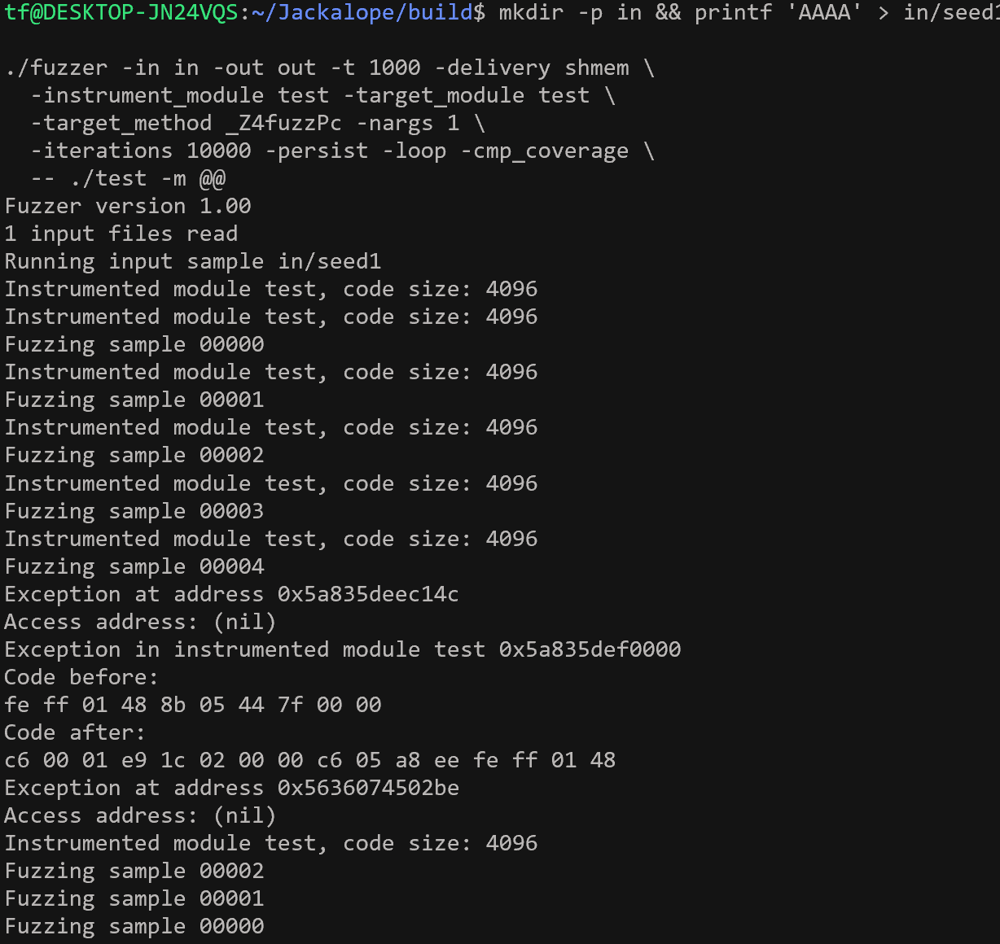
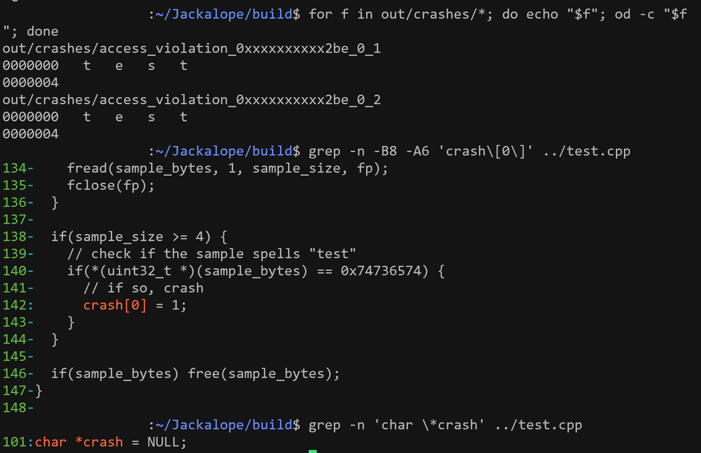

## 미션

**미션 목표**
퍼징이 무엇인지 공부하고 여러가지 퍼저에 대해 알아보자

**수행 과정**
1. fuzzing이 무엇인지 어떤 종류가 있는지 학습해 본다.
2. 여러 종류의 fuzzer에 대해 알아보고 차이점들을 알아본다.
3. 블로그로 정리한다.

## 들어가기 전

작년에 동아리 연합 세미나에서 선배가 fuzzing에 대해 발표하셨는데 그때 fuzzing이 뭔지 몰라서 슬펐던 기억이 있다.

웹 해킹을 공부하면서 자연스럽게 fuzzing 도구를 접하게 되었는데 내가 접했던 건 Gobuster(디렉토리, 파일, DNS 등을 찾는 Go 도구), dirsearch(웹 경로 스캐너), ffuf랑 Burp Intruder 기능 정도다. ZAP Fuzzer도 접해보긴 했다.

fuzzing에 대해 정확한 건 아직 모른다. 근데 DAST랑 다른 점이 무엇인지 궁금하다.

지금부터 fuzzing이 무엇이고 어떤 종류가 있는지, 여러 종류의 fuzzer와 차이점들을 공부해서 기록해보겠다.

---

## 1. fuzzing(퍼징)이 뭘까?

대상 프로그램에 예상치 못한 입력(잘못된 형식이나 범위를 벗어난 값 등)을 자동으로 넣어 실행하고, 그 반응을 관찰해서 버그, 취약점, 의도하지 않은 동작을 찾아내는 것을 목표로 하는 테스트 기술이다.

그리고 그 테스트를 하는 도구를 fuzzer라 이해했다.

OWASP 문서에서는 간단한 예시를 들어준다.
3가지 질문 중 유저의 선택을 저장하는 프로그램의 정수(integer)를 생각해보자. 유효한 선택값은 0, 1, 2다. 그런데 만약에 우리가 3이나 255를 보내면? switch문의 default case가 안전하게 구현되어 있지 않다면 프로그램은 crash(충돌)하거나 고전적인 보안 이슈(버퍼 오버플로우, DoS 등)가 발생할 수 있다는 것이다.

사람이 이런 값을 하나씩 넣어보는 대신, fuzzer는 입력을 자동으로 대량 생성해 넣고 crash 같은 이상 반응을 지켜본다. 그래서 Fuzzing은 프로그램을 실행하면서 자동으로 버그를 찾는 기술이다.

### 퍼징 과정

1. **테스트 케이스 생성:** 대상 프로그램에 넣을 입력값 생성
2. **테스트 실행:** 생성된 입력으로 대상 프로그램을 실행
3. **모니터링:** 충돌(crash), 정지(hang), 메모리 누수(memory leak), 다른 예상치 못한 행동을 지켜본다.
4. **충돌 분석:** 테스트가 실패했을 때 무엇이 잘못되었는지 확인한다.

### 어떤 경우에 사용할까?

- 신뢰할 수 없는 곳에서 입력을 받는 소프트웨어
- 두 가지 복잡한 알고리즘이 같은 결과를 내는지 확인할 때
- 복잡한 입력을 받는 대용량 API의 안정성 검증

### 그럼 DAST랑은 뭐가 다를까?

- **SAST**는 프로그램을 실행하지 않고 코드를 분석한다.
- **DAST**는 실행 중인 애플리케이션을 검사하는 테스트 범주다.
- **퍼징**은 입력을 자동으로 대량으로 넣어보는 테스트 기법이다.

즉 DAST는 "실행 중인 것을 검사한다"는 분류고, 퍼징은 "어떻게 검사하는지"에 대한 방법이다. DAST에서도 퍼징을 쓰지만, 퍼징은 웹 애플리케이션뿐 아니라 라이브러리 함수나 파일 파서 같은 대상에도 쓴다.

---

## 2. 어떤 종류의 fuzzing이 있을까?

### 2-1. 입력을 어떻게 만드는지 (시작할 때 무엇이 필요할까?)

종류: mutation-based, generation-based

**mutation-based**

mutation이라는 단어 그대로 변이시켜 입력을 만드는 것이다. 처음에 준 예시 입력(seed) 모음(corpus)을 바꿔서 어느 정도 정상인 입력을 만든다.

유효한 입력 수정 → 테스트

ex) 유효한 JSON 문서로 시작
- `}`(closing bracket) 제거
- 문자열 값을 매우 긴 문자열로 변경
- 숫자를 특수 문자로 바꾸기
- 중복된 key 이름 넣기

**generation-based**

테스트 입력을 처음부터 생성하기 때문에 seed의 유무나 품질에 의존하지 않는다. 더 많은 설정이 필요하지만, 특히 복잡한 입력 형식에서 더 높은 coverage를 낼 수 있다.

**guided fuzzing**

새로 만든 입력을 실행해 보고, 그 결과(feedback)를 다음 입력을 만들 때 활용하는 방식이다. 주로 mutation과 함께 쓴다. 아래 3번에서 자세히 정리했다.

### 2-2. 입력 구조(input structure)를 아는가?

- **dumb:** 형식을 모른다. 준비는 쉽겠지만 형식 검사에서 걸러지기 쉽다.
- **smart:** 형식을 안다. 검사를 통과해 더 안쪽 코드에 도달하기 쉽지만 형식을 알려주는 준비가 필요하다.

### 2-3. 프로그램 내부를 얼마나 보는지 (무엇을 알고 퍼징할까?)

종류: black-box, grey-box, white-box

- **black-box:** 말 그대로 애플리케이션 내부를 모른 채 테스트한다. 빠르고 병렬화하기 쉽지만 깊은 버그는 놓치기 쉽다.
- **grey-box:** 가벼운 계측(instrumentation)으로 입력이 어떤 코드를 실행했는지 보고 그 정보를 활용한다.
- **white-box:** 기호 실행(symbolic execution) 같은 프로그램 분석으로 더 많은 코드나 중요한 위치에 도달하려 한다. 깊은 버그를 찾을 수 있지만 느릴 수 있다.

내부를 보는 정도: black < grey < white

---

## 3. coverage-guided fuzzing이 뭐야?

**coverage**는 프로그램의 코드 중에서 **실행해 본 부분**을 말한다.
**coverage-guided fuzzing**은 "새로운 코드를 실행시킨 입력"을 저장해 두고, 그 입력을 다시 변형하는 방식이다.

`FUZZ`를 입력해야 crash가 나는 프로그램을 예로 들면 이렇다.

| 단계 | 만들어진 입력(예시) | 결과 |
|---|---|---|
| 1 | `AAAA` | 첫 번째 조건에서 막힘 |
| 2 | `FAAA` | **처음 보는 코드 실행** → 저장 |
| 3 | `FUAA` (`FAAA`를 변형) | 또 새로운 코드 → 저장 |
| 4 | `FUZA` | 또 저장 |
| 5 | `FUZZ` | crash! |

게임에서 중간 저장을 하는 것과 비슷하다. 한 글자를 맞히면 저장하고 거기서부터 다시 시도한다.

- 저장 없이 4바이트를 한 번에 맞힐 확률: 1/256⁴ = 약 43억분의 1 (헉...)
- 한 글자씩 저장하면서 가면: 한 번에 한 글자만 맞히면 되니까 훨씬 빠르다.

이때 "새로운 코드가 실행됐는지" 알아야 하므로 프로그램에 기록용 코드를 심는데, 이것이 **계측(instrumentation)** 이다.

---

## 4. 직접 실행해보고 차이점을 찾아보자!

AFL++, Jackalope, libFuzzer (대표적인 fuzzer 세 가지)
뭐든 직접 해봐야 이해가 빠른 것 같다.

환경: WSL, Clang

---

## 5. libFuzzer부터! (세 개 중에 비교적 간단…?)

### 5-1. libFuzzer란?

LLVM 프로젝트의 coverage-guided 퍼징 엔진이다. 테스트할 코드와 함께 빌드하면 libFuzzer가 입력을 만들어 정해진 함수를 한 프로세스 안에서 반복 호출한다. 새로운 코드를 실행한 입력은 저장해 두고 다시 변형한다.

### 5-2. fuzz target 작성

"FUZZ" 찾기! 입력이 `FUZZ`로 시작하면 `abort()`를 호출하는 코드를 작성했다. `abort()`는 프로그램을 강제로 비정상 종료시키는 함수다. 즉 **일부러 crash가 나는 지점을 심어 둔 것**이다.



| 코드 | 뜻 |
|---|---|
| `LLVMFuzzerTestOneInput` | libFuzzer가 호출하는 함수 (이름이 정해져 있다) |
| `data` | libFuzzer가 만든 입력 |
| `size` | 입력의 바이트 수 |
| `data[0]` | 입력의 첫 번째 글자 |
| `return 0;` | 이번 입력은 문제없이 끝났다 |

`main()`이 없는 이유는 libFuzzer가 `main()`을 가지고 있기 때문이다.

### 5-3. 첫 실행: heap-buffer-overflow

```bash
clang -g -O1 -fsanitize=fuzzer,address target.c -o fuzz
./fuzz -seed=1
```

| 명령어 부분 | 뜻 |
|---|---|
| `clang` | C 컴파일러 |
| `-g` | 디버깅 정보 포함 (에러 위치를 줄 번호로 알 수 있다) |
| `-O1` | 가벼운 최적화 |
| `-fsanitize=fuzzer` | libFuzzer를 합치고 coverage 계측을 넣는다 |
| `address` | 메모리 오류를 잡는 AddressSanitizer를 켠다 |
| `-o fuzz` | 실행 파일 이름을 `fuzz`로 |
| `./fuzz -seed=1` | 실행. 난수 시작값을 1로 고정 |



그런데 `FUZZ`를 찾기도 전에 다른 에러가 났다.

- `heap-buffer-overflow`: 할당된 메모리 범위를 벗어났다.
- `READ of size 1`: 범위 밖의 1바이트를 읽었다.

원인은 **1바이트 입력 `F`** 였다. `data[0] == 'F'`를 통과한 뒤 `data[1]`을 읽었는데, 입력이 1바이트라 두 번째 칸이 없었다. `size`를 확인하지 않은 **내 테스트 함수의 버그**였다.

### 5-4. 수정



`data[3]`까지 읽으려면 4바이트 이상이어야 해서 `size >= 4` 조건을 추가했다.

### 5-5. 결과

같은 명령으로 다시 빌드하고 실행했다.



로그 한 줄은 이렇게 읽는다.

| 표시 | 뜻 |
|---|---|
| `#1815` | 1815번째 실행 |
| `INITED` | 초기 준비 완료 |
| `NEW` | 새로운 coverage를 만든 입력을 저장 |
| `REDUCE` | 같은 coverage를 내는 더 짧은 입력으로 교체 |
| `cov` | 지금까지 실행해 본 코드 지점의 수 |
| `corp: 3/9b` | 저장한 입력 3개, 총 9바이트 |
| `L: 4/4` | 이번 입력 길이 / 저장된 입력 중 최대 길이 |
| `MS` | 이 입력을 만들 때 쓴 변형 방법 (비트 바꾸기, 바이트 삽입 등) |
| `deadly signal` | 프로그램이 비정상 종료됨 = **`abort()` 실행** |

코드 구조와 로그 순서로 보면 `cov`가 늘 때 새로 통과한 조건은 다음처럼 해석할 수 있다.

| 실행 번호 | cov | 새로 통과한 조건 |
|---|---|---|
| #12 | 3 | `size >= 4` |
| #1815 | 4 | `data[0] == 'F'` |
| #15438 | 5 | `data[1] == 'U'` |
| #66344 | 6 | `data[2] == 'Z'` |
| #67190 직후 | crash | `data[3] == 'Z'` → `abort()` |

### 5-6. crash 입력 확인과 수정 검증

crash를 일으킨 입력은 `crash-...` 파일로 저장된다.



| 명령어 | 뜻 |
|---|---|
| `od -c crash-*` | crash 파일들의 내용을 글자 단위로 보여준다 |
| `for f in crash-*; do echo "$f"; od -c "$f"; done` | 파일을 하나씩, 이름과 내용을 같이 보여준다 |
| `./fuzz crash-파일이름` | 퍼징하지 않고 그 입력 하나만 다시 실행한다 |

처음에 `FUZZF`처럼 보인 건 파일 두 개의 내용이 이어서 출력된 것이었다.

- `FUZZ`: 이번에 찾은 입력 (일부러 심어 둔 `abort()`)
- `F`: 처음에 heap-buffer-overflow를 일으킨 입력 (내 코드의 실수)

수정한 프로그램에 `F` 파일을 다시 넣었더니 overflow 없이 `Executed ... in 0 ms`로 끝났다. 수정 확인! 마지막의 `NOTE`는 입력 하나만 실행했고 퍼징은 하지 않았다는 안내다.

### 5-7. 배운 점

- 정답을 알려주지 않았는데 fuzzer가 `FUZZ`를 찾아냈다.
- 무작위로 한 번에 맞힐 확률은 약 43억분의 1인데, 약 6만7천 번대에서 도달했다. 조건을 하나 통과한 입력을 저장하고 이어서 변형했기 때문이다.
- 테스트 함수도 입력 길이를 확인하지 않으면 버그가 생긴다.
- AddressSanitizer는 어떤 접근이 범위를 벗어났는지 알려준다.

---

## 6. 이제 AFL++를 해보겠다

아까랑 다르게 뭔가 디스플레이가 좀 멋있는 것 같다.

AFL++는 Google의 AFL을 fork해 발전시킨 퍼저다. libFuzzer에서 쓴 `target.c`를 그대로 사용했다.

### 6-1. 빌드와 실행

```bash
AFL_USE_ASAN=1 afl-clang-fast -g -O1 -fsanitize=fuzzer target.c -o fuzz_afl
mkdir -p seeds
printf 'AAAA' > seeds/seed1
AFL_SKIP_CPUFREQ=1 AFL_I_DONT_CARE_ABOUT_MISSING_CRASHES=1 afl-fuzz -i seeds -o out -- ./fuzz_afl
```

| 명령어 부분 | 뜻 |
|---|---|
| `AFL_USE_ASAN=1` | AddressSanitizer를 켠다 |
| `afl-clang-fast` | AFL++의 계측을 넣어주는 컴파일러 |
| `mkdir -p seeds` | seed 폴더 만들기 |
| `printf 'AAAA' > seeds/seed1` | `AAAA`가 담긴 초기 입력 파일 만들기 |
| `AFL_SKIP_CPUFREQ=1`, `AFL_I_DONT_CARE_ABOUT_MISSING_CRASHES=1` | 시작 전 시스템 설정 점검 일부를 건너뛴다 |
| `afl-fuzz` | 퍼저 실행 |
| `-i seeds` | 초기 입력 폴더 |
| `-o out` | 결과 저장 폴더 |
| `-- ./fuzz_afl` | 퍼징할 프로그램 |

처음에는 터미널 창이 작아 상태 화면이 나오지 않았다. 창을 79×24 이상으로 키우니 해결됐다.

### 6-2. 결과



| 화면 항목 | 값 | 뜻 |
|---|---|---|
| `run time` | 52초 | 실행한 시간 |
| `last saved crash` | 51초 전 | 시작하고 약 1초 만에 crash를 저장했다 |
| `saved crashes` | 1 | 저장한 crash 입력 수 |
| `corpus count` | 5 | 저장 중인 입력 수 (seed 1개 + 새로 찾은 4개) |
| `total execs` | 680k | 총 실행 횟수 (crash 발견 후 실행한 것도 포함) |
| `exec speed` | 10.7k/sec | 초당 실행 횟수 |

crash를 찾은 후에도 계속 실행이 돼서 `Ctrl+C`로 종료시켜줘야 한다.

crash 파일 이름에도 정보가 들어 있다.

| 이름 부분 | 뜻 |
|---|---|
| `sig:06` | `abort()`가 보내는 신호(SIGABRT) |
| `time:1002` | 시작 후 1002ms, 약 1초에 발견 |
| `execs:30785` | 30,785번째 실행에서 발견 |
| `op:havoc` | 여러 변형을 무작위로 섞는 단계에서 만들어짐 |

찾은 입력은 `FUZZZZ...ZFF`로 31바이트였다(`od`의 `0000037`은 8진수라서 31이다). 길어도 코드는 앞의 4바이트만 확인하므로 `FUZZ`로 시작하면 `abort()`가 호출된다. AFL++도 결국 `FUZZ`를 찾은 것이다.

---

## 7. 이제 Jackalope로 해보자

Jackalope는 coverage-guided 퍼저인데, 소스코드가 없는 실행 파일(black-box binary)도 퍼징할 수 있다. TinyInst라는 도구로 **실행 중인 프로그램에 계측**을 넣는다.

이번 대상은 Jackalope에 들어 있는 예제 `test.cpp`다. 앞에서처럼 fuzz target 함수만 만드는 게 아니라, `main()`이 있는 일반 프로그램 안의 `fuzz` 함수를 퍼징한다. (Linux에서는 Clang으로 빌드해야 한다.)

### 7-1. 실행

```bash
mkdir -p in && printf 'AAAA' > in/seed1

./fuzzer -in in -out out -t 1000 -delivery shmem \
  -instrument_module test -target_module test \
  -target_method _Z4fuzzPc -nargs 1 \
  -iterations 10000 -persist -loop -cmp_coverage \
  -- ./test -m @@
```

| 옵션 | 뜻 |
|---|---|
| `-in`, `-out` | 초기 입력 폴더, 결과 폴더 |
| `-t 1000` | 입력 하나의 제한 시간 1000ms |
| `-delivery shmem` | 입력을 파일 대신 공유 메모리로 전달 |
| `-instrument_module test` | coverage를 수집할 모듈 |
| `-target_module test` | 반복 실행할 함수가 들어 있는 모듈 |
| `-target_method _Z4fuzzPc` | 반복 실행할 함수. C++ 함수 `fuzz(char*)`의 Linux용 내부 이름 |
| `-nargs 1` | 그 함수의 인자는 1개 |
| `-iterations 10000 -persist -loop` | 프로세스를 매번 새로 켜지 않고 함수를 최대 1만 번 반복한 뒤 재시작 |
| `-cmp_coverage` | 여러 바이트를 한 번에 비교하는 조건을 통과하기 쉽게 해준다 |
| `-- ./test -m @@` | 대상 프로그램. `@@`는 공유 메모리 이름으로 바뀐다 |



| 출력 | 뜻 |
|---|---|
| `Instrumented module test` | `test`에 계측을 넣었다 |
| `Fuzzing sample 00004` | 저장한 4번 입력을 변형하며 테스트 중 |
| `Exception at address ...` | 대상 프로그램에서 예외(crash) 발생 |
| `Access address: (nil)` | 주소 0(NULL)에 접근하다가 터졌다 |
| `Code before / after` | 예외가 난 위치 앞뒤의 기계어 |

### 7-2. 뭘 찾은 걸까?



찾은 입력은 `test`다. 파일 이름 끝의 `_1`, `_2`는 같은 crash의 입력이 여러 번 저장된 것이다.

코드를 보면 이유를 알 수 있다.

1. 101번 줄: `char *crash = NULL;` → `crash`는 아무 곳도 가리키지 않는다.
2. 138번 줄: 입력이 4바이트 이상인지 확인한다.
3. 140번 줄: 앞 4바이트가 `0x74736574`인지 비교한다. 낮은 바이트부터 저장하는 리틀 엔디언이라 메모리에는 `74 65 73 74`, 즉 `test` 순서다.
4. 142번 줄: `crash[0] = 1;` → NULL 주소에 값을 쓰려다 crash! 그래서 `(nil)`이라고 나왔다.

이것도 예제에 **일부러 심어 둔 crash**다.

내 `target.c`는 한 글자씩 4번 비교했지만, 여기는 **4바이트를 한 번에** 비교한다. 그러면 중간까지 맞아도 새로운 코드가 실행되지 않는데, `-cmp_coverage`가 비교가 얼마나 맞았는지를 추가 단서로 쓰게 해준다.

---

## 8. 세 퍼저 비교

| 항목 | libFuzzer | AFL++ | Jackalope |
|---|---|---|---|
| 계측 방법 | 컴파일할 때 | 컴파일할 때 (소스가 없으면 QEMU 모드 등) | 실행 중 바이너리에 (TinyInst) |
| 소스코드 | 필요 | 이번엔 사용, 없어도 가능 | 없어도 가능 |
| 이번 대상 | fuzz target 함수 | 같은 fuzz target | `main()`이 있는 프로그램의 함수 |
| 시작 입력 | 빈 corpus | `AAAA` | `AAAA` |
| 화면 | 로그 | 상태 화면 | 로그 |
| crash 발견 후 | 종료 | 계속 실행 | 계속 실행 |
| 찾은 입력 | `FUZZ` (4바이트) | `FUZZ...` (31바이트) | `test` (4바이트) |
| 저장 위치 | `crash-*` | `out/default/crashes/` | `out/crashes/` |
| 특징 | 간단함. 큰 새 기능 없이 중요한 버그 위주로 수정 중 | 기능이 많음 | Windows, macOS, Linux, Android의 바이너리 지원 |

각각 한 번씩만 실행했고 시작 입력과 대상도 달라서, 이 결과만으로 어느 퍼저가 더 빠른지는 판단할 수 없다.

**내가 이해한 선택 기준**

- 소스코드가 있고 함수 하나를 빠르게 테스트하고 싶다 → libFuzzer
- 오래 돌리면서 다양한 기능을 쓰고 싶다 → AFL++
- 소스코드 없는 프로그램을 테스트해야 한다 → Jackalope (AFL++의 바이너리 모드도 후보)

---

## 마무리

- fuzzing은 입력을 자동으로 많이 넣어보면서 프로그램의 이상 반응을 찾는 기술이다.
- coverage-guided fuzzing은 새로운 코드를 실행한 입력을 저장하고 다시 변형해서 점점 깊이 들어간다.
- 이번에 찾은 `FUZZ`, `test`는 일부러 심어 둔 crash였고, `F`로 터진 overflow는 내가 실수로 만든 버그였다.
- 세 퍼저 모두 coverage를 활용하지만, 계측하는 방법과 대상에 따라 쓰임새가 다르다.

## 참고 자료

- [OWASP: Fuzzing](https://community.owasp.org/Fuzzing)
- [Better Stack: Fuzz Testing 입문 가이드](https://betterstack.com/community/guides/testing/fuzz-testing/) ← 이 자료가 도움이 많이 됨
- [Wikipedia: Fuzzing](https://en.wikipedia.org/wiki/Fuzzing)
- [google/fuzzing: Why fuzz?](https://github.com/google/fuzzing/blob/master/docs/why-fuzz.md)
- [libFuzzer 공식 문서](https://llvm.org/docs/LibFuzzer.html)
- [AFL++](https://github.com/AFLplusplus/AFLplusplus)
- [Jackalope](https://github.com/googleprojectzero/Jackalope)
- [google/fuzzing](https://github.com/google/fuzzing): 퍼징 튜토리얼, 예제 등 자료 모음
